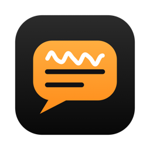

<h1 align="center">BabbleBuster</h1>

<b>Hold a key, talk, let go — clean, ready-to-send text appears in whatever app you're using.</b>

BabbleBuster is a dictation app for the Mac menu bar. It turns speech into polished text entirely on
your Mac: no account, no subscription, no cloud. Your voice and your words never leave your computer.

**[Download the latest release →](../../releases/latest)**

---

## What it does

### Dictate anywhere
- **Hold to talk.** Hold **Fn/Globe** (or Right Option, Right Command, Right Control or Right Shift),
  speak, and release. The text is pasted into the app you're typing in — Mail, Slack, Notes,
  your browser, your editor.
- **Hands-free.** Double-tap the key to keep listening without holding it; tap once more to stop.
  You can also set a separate toggle key. **Esc** cancels.
- **Paste last dictation** (⌃⌥V by default) re-inserts your most recent dictation, even after the
  clipboard has changed.
- Your clipboard is restored after every paste, and dictation is automatically disabled in password
  fields and secure-input prompts.

### Speech recognition on your Mac
- **NVIDIA Parakeet** speech recognition running on the Apple Neural Engine — fast and accurate
  (seconds of speech are transcribed in well under a second).
- Choose **Parakeet v2** (English) or **Parakeet v3** (25 European languages), or Apple's on-device
  speech recognizer.
- Pick which microphone to use; very short or silent recordings are caught rather than inserted.

### Cleanup that keeps your meaning
Raw speech is messy. BabbleBuster tidies it up so it reads like you typed it:

| Level | What happens |
|---|---|
| **Off** | Exactly what you said. |
| **Light** | Punctuation, capitals, filler words (*um, uh*), repeated words, and spoken corrections — *"Friday, no wait, Thursday"* becomes *"Thursday"*. |
| **Medium** | Light, plus stutters, abandoned restarts, and bulleted lists when you count items off. |
| **High** | Medium, plus tighter, more polished sentences. |

- **Styles:** Casual, Relaxed, Standard or Formal — plus your own instructions
  (e.g. *"Use British spelling"*).
- **Per-app rules:** email layout in Mail and Outlook, a relaxed tone in Slack and Messages,
  code-safe output (no stray punctuation) in Terminal, Xcode and VS Code — add your own for any app.
- **Spoken commands:** *"new line"*, *"new paragraph"*, *"scratch that"*.
- **Safety checks on every result.** Before anything is inserted, BabbleBuster verifies that the
  cleaned text still contains your numbers, names, negations ("don't", "not"), email addresses, URLs
  and file paths, that nothing new was invented, and that a question you dictated wasn't
  *answered* instead of transcribed. If a check fails it falls back to a safer version automatically.
- Cleanup models run locally: **"S1-mini" by "Superwhisper"** for Light/Medium, and optionally
  **Qwen3 1.7B** or **Apple Intelligence** for High and custom instructions.

### A dictionary that learns
- Add names, product names and jargon so they're always spelled your way.
- **Heard-as** spellings (*"pt vault"* → *PTVault*), exact **replacements** (*"btw"* → *by the way*)
  and **snippets** (say *"my calendar link"* to insert a long block of text).
- Near-misses of your terms are corrected automatically.
- **Learns from your corrections:** if you fix a misheard word right after dictating, BabbleBuster can
  suggest — or automatically add — the right spelling.
- **Import from Wispr Flow**, plus JSON import/export.

### History & insights
- Searchable history of every dictation, with **audio playback**, the raw transcript, the cleaned
  result and a **before/after diff**. Re-clean or re-transcribe any entry. Choose how long history
  and recordings are kept, or turn history off.
- **Insights:** words dictated, speaking speed, time saved versus typing, daily streaks, an activity
  calendar, which apps you dictate into and when — plus a shareable stats card.

### Made for the Mac
- Lives in the menu bar; a small floating overlay shows a live waveform while you talk. Dock it to
  any screen edge or drag it anywhere; light, dark, colour or monochrome.
- Sound cues, launch at login, a **Try Out** playground to see what each cleanup stage does, and a
  guided first-run setup.

---

## Requirements

- Mac with **Apple Silicon** (M1 or later)
- **macOS 15 Sequoia** or later (Apple Intelligence cleanup needs macOS 26+ with Apple Intelligence enabled)
- About **1 GB** of disk space for the local models (1.1 GB more if you add Qwen3 for the High level)

## Install

1. Download `BabbleBuster-<version>.dmg` from the [latest release](../../releases/latest) and open it.
2. Drag **BabbleBuster** onto the **Applications** shortcut, then eject the disk image.
   *(Ignore the release's "Source code" links — GitHub adds them automatically and they only
   contain this README.)*
3. Open it. BabbleBuster is not notarized by Apple, so the first time macOS will say it can't verify
   the developer. Click **Done**, then go to **System Settings → Privacy & Security**, scroll down and
   click **Open Anyway** next to BabbleBuster.
   *(Or, in Terminal: `xattr -dr com.apple.quarantine /Applications/BabbleBuster.app`)*
4. Follow the welcome window:
   - Grant **Microphone** (used only while you dictate) and **Accessibility** (to detect the dictation
     key and paste text). Some Macs also need **Input Monitoring**.
   - The speech and cleanup models download once from Hugging Face (~1 GB) and then work offline.
   - If you use **Fn** as the dictation key, click **Set to Do Nothing** for the Globe key so a lone
     Fn press reaches BabbleBuster instead of opening the emoji picker.

## Privacy

- Audio is processed on your Mac and never uploaded.
- The only network access is downloading model files from huggingface.co.
- History, recordings and your dictionary are stored in `~/Library/Application Support/BabbleBuster`
  and can be deleted from Settings at any time.

## Uninstall

Quit BabbleBuster from the menu bar, then delete:

- `/Applications/BabbleBuster.app`
- `~/Library/Application Support/BabbleBuster` (history, dictionary, cleanup models)
- `~/Library/Application Support/FluidAudio` (speech models)

and remove BabbleBuster from **System Settings → Privacy & Security → Accessibility / Microphone / Input Monitoring**.

## Credits

BabbleBuster is built on: NVIDIA Parakeet (CC-BY-4.0) via FluidAudio (Apache-2.0); "S1-mini" by
"Superwhisper" (Apache-2.0 with naming term); Qwen3 by Alibaba Cloud (Apache-2.0); llama.cpp (MIT).
Full license texts are in `THIRD_PARTY_NOTICES.md`, attached to each release and inside the app
(`BabbleBuster.app/Contents/Resources`).

© RSecLabs. The source code for BabbleBuster is not public.
